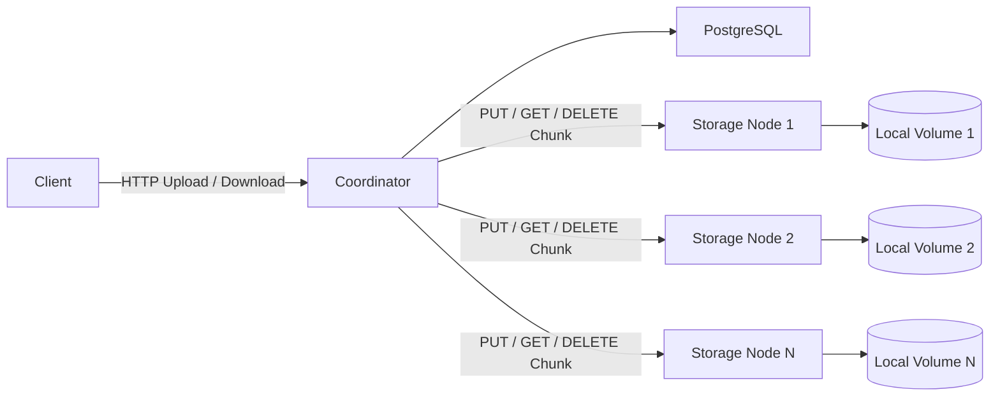

# Architecture

## نمای کلی

## مسئولیت‌ها

### Coordinator

- API عمومی Upload، Download، Metadata و Delete
- اعتبارسنجی اندازه و Metadata ورودی
- انتخاب Nodeهای سالم
- تثبیت Placement برای Upload
- محاسبه offset/size هر Chunk
- Streaming و Dispatch Chunkها به Nodeها
- ثبت وضعیت‌ها در PostgreSQL
- بازسازی فایل هنگام Download

Coordinator یک Control Plane کوچک و Data Plane ساده را با هم انجام می‌دهد. در آینده می‌توان Data Plane را جدا کرد؛ برای نسخه آموزشی این جداسازی لازم نیست.

### Storage Node

- ارائه Health و Heartbeat
- دریافت Chunk به شکل Streaming
- نوشتن در فایل موقت
- محاسبه و اعتبارسنجی SHA-256
- Commit اتمیک با Rename
- خواندن و حذف Chunk با storage_key
- نگهداری فایل‌ها در Volume مستقل

Storage Node نباید درباره تعداد Chunkها یا Node مقصد تصمیم بگیرد.

### PostgreSQL

Metadata، وضعیت‌ها، Nodeها و Placement را نگه می‌دارد. تراکنش DB نباید در طول انتقال شبکه باز بماند.

## پروتکل Upload

1. Client درخواست Upload می‌فرستد و اندازه فایل را اعلام می‌کند.
2. Coordinator اندازه و محدودیت‌ها را بررسی می‌کند.
3. Coordinator Nodeهای سالم و دارای فضای کافی را انتخاب می‌کند.
4. Coordinator یک Upload و N Chunk با offset/size مشخص در DB ثبت می‌کند و ظرفیت هر Chunk را در همان تراکنش کوتاه رزرو می‌کند تا Upload هم‌زمان ظرفیت تکراری نگیرد.
5. فایل ورودی به صورت Stream خوانده می‌شود؛ هر بازه به Node متناظر ارسال می‌شود.
6. Node فایل موقت را می‌نویسد و checksum را کنترل می‌کند.
7. Node پس از موفقیت، فایل را اتمیک به storage_key نهایی Rename می‌کند.
8. Coordinator وضعیت Chunk را `stored` می‌کند.
9. فقط وقتی تمام Chunkها stored شدند، Upload و File موفق/active می‌شوند.

Chunkها در نسخه فعلی sequential ارسال می‌شوند و تعداد Uploadهای هم‌زمان سقف پیکربندی‌شده دارد. از ساخت Goroutine به تعداد نامحدود Chunk/درخواست پرهیز شود.

## پروتکل Download

1. فقط فایل active و Upload completed قابل دانلود است.
2. Coordinator Chunkها را بر اساس `chunk_index` می‌خواند.
3. هر Node، Chunk متناظر را به صورت Stream برمی‌گرداند.
4. Coordinator checksum هر Chunk را بررسی می‌کند.
5. بایت‌ها به ترتیب در فایل موقت Coordinator نوشته می‌شوند.
6. checksum کل فایل نیز بررسی می‌شود.

Coordinator ابتدا کل فایل را به صورت Stream در فایل موقت محلی بازسازی می‌کند. اندازه و checksum تک‌تک Chunkها و سپس checksum فایل کامل پیش از ارسال کنترل می‌شوند. این روش فضای موقت دیسک به اندازه فایل می‌خواهد؛ فایل موقت پس از پایان یا خطا حذف می‌شود.

## محاسبه حافظه

از `io.CopyN` یا `io.LimitReader` و Buffer محدود استفاده کن. کل فایل را با `os.ReadFile` یا `io.ReadAll` در RAM قرار نده.

اگر هم‌زمانی C و Buffer انتقال B باشد، حافظه انتقال تقریباً O(C × B) است، نه O(file size).

## خطا و Consistency

- خطای یک Node: Upload `failed` می‌شود؛ Chunkهای ذخیره‌شده برای Cleanup قابل شناسایی می‌مانند.
- Crash Coordinator: Upload نیمه‌تمام با expires_at پیدا و پاک‌سازی می‌شود؛ ظرفیت رزروشده پس از حذف Chunkها آزاد می‌شود.
- Crash Node حین نوشتن: فایل موقت باقی می‌ماند و Cleanup محلی آن را حذف می‌کند.
- تکرار PUT یک Chunk: همان storage_key باید idempotent مدیریت شود.
- Delete: ابتدا metadata به deleting می‌رود؛ سپس حذف Nodeها انجام می‌شود؛ بعد status به deleted تغییر می‌کند.
- از Transaction طولانی هنگام network I/O اجتناب شود.

## امنیت پایه

- Storage Nodeها فقط روی شبکه داخلی قابل دسترسی باشند.
- ارتباط Coordinator و Node با یک توکن داخلی تصادفی یا mTLS محافظت شود؛ در MVP حداقل توکن داخلی در Header.
- مسیر فایل از ورودی Client ساخته نشود؛ storage_key از UUID داخلی ساخته شود.
- محدودیت اندازه و Timeout اجباری باشد.
- نام اصلی فایل فقط Metadata است و در مسیر فیزیکی استفاده نمی‌شود.
- خطاهای داخلی و مسیرهای سرور به Client نشت نکنند.
