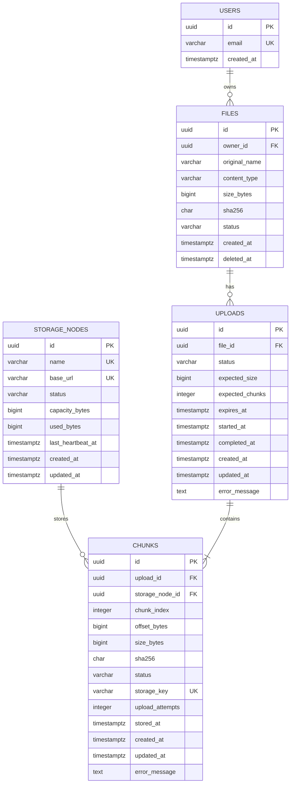

# ERD — مدل داده نسخه 1.0

## اصول مدل

- PostgreSQL فقط Metadata را نگه می‌دارد؛ بایت فایل‌ها در Filesystem هر Storage Node ذخیره می‌شوند.
- هر Upload در زمان شروع، مجموعه‌ای ثابت از Nodeها را رزرو می‌کند.
- در نسخه 1.0 تعداد Chunkها برابر تعداد Nodeهای رزروشده است.
- هر Chunk دقیقاً روی یک Node ذخیره می‌شود؛ Replication نداریم.
- تمام Chunkها برای بازسازی فایل لازم‌اند.

## ERD



## توضیح موجودیت‌ها

### users

در نسخه 1.0 برای جداسازی مالکیت فایل‌ها در نظر گرفته شده است. احراز هویت واقعی می‌تواند در مراحل بعدی اضافه شود؛ در MVP می‌توان یک کاربر ثابت/داخلی داشت یا احراز هویت را تا بعد از مسیر اصلی به تعویق انداخت.

| ستون | نوع | توضیح |
|---|---|---|
| id | UUID | شناسه کاربر |
| email | VARCHAR | شناسه یکتا |
| created_at | TIMESTAMPTZ | زمان ایجاد |

### files

رکورد منطقی فایل است؛ با یک Upload عملیاتی یکی نیست. این جداسازی اجازه می‌دهد بعداً فایل نسخه‌های متعدد یا Upload مجدد داشته باشد.

| ستون | نوع | توضیح |
|---|---|---|
| id | UUID | شناسه فایل |
| owner_id | UUID | مالک فایل |
| original_name | VARCHAR | نام اصلی فقط Metadata؛ هرگز مسیر ذخیره‌سازی نیست |
| content_type | VARCHAR | نوع محتوای اعلام‌شده |
| size_bytes | BIGINT | اندازه فایل اصلی |
| sha256 | CHAR(64) | SHA-256 فایل اصلی |
| status | VARCHAR | `active`, `deleting`, `deleted`, `unavailable` |
| created_at | TIMESTAMPTZ | زمان ایجاد |
| deleted_at | TIMESTAMPTZ | زمان حذف منطقی |

### uploads

یک تلاش برای Upload کردن یک فایل. Placement و تعداد Chunkها در این سطح تثبیت می‌شوند.

| ستون | نوع | توضیح |
|---|---|---|
| id | UUID | شناسه Upload |
| file_id | UUID | فایل منطقی |
| status | VARCHAR | `pending`, `uploading`, `completed`, `failed`, `deleting`, `deleted` |
| expected_size | BIGINT | اندازه مورد انتظار |
| expected_chunks | INT | تعداد Node/Chunk رزروشده |
| expires_at | TIMESTAMPTZ | مهلت Upload نیمه‌تمام |
| started_at | TIMESTAMPTZ | شروع انتقال |
| completed_at | TIMESTAMPTZ | تکمیل موفق |
| created_at / updated_at | TIMESTAMPTZ | زمان‌ها |
| error_message | TEXT | خطای خلاصه‌شده، بدون اطلاعات حساس |

### storage_nodes

هر رکورد نماینده یک Storage Node مستقل است.

| ستون | نوع | توضیح |
|---|---|---|
| id | UUID | شناسه پایدار Node |
| name | VARCHAR | نام قابل‌خواندن |
| base_url | VARCHAR | آدرس داخلی API |
| status | VARCHAR | `active`, `draining`, `disabled` |
| capacity_bytes | BIGINT | ظرفیت اعلام‌شده |
| used_bytes | BIGINT | فضای مصرف‌شده به‌علاوه ظرفیت رزروشده Uploadهای جاری/نیمه‌تمام |
| last_heartbeat_at | TIMESTAMPTZ | آخرین heartbeat موفق |
| created_at / updated_at | TIMESTAMPTZ | زمان‌ها |

Node فقط وقتی قابل انتخاب است که status آن `active`، heartbeat تازه و فضای آزاد کافی داشته باشد. مقدار capacity اعلامی Node است و تضمین فضای واقعی Filesystem نیست؛ Coordinator ظرفیت metadata را هنگام ایجاد Upload در تراکنش رزرو می‌کند و پس از حذف یا پاک‌سازی آزاد می‌کند.

### chunks

هر ردیف نماینده یک بازه از فایل اصلی است که روی یک Node مشخص ذخیره می‌شود.

| ستون | نوع | توضیح |
|---|---|---|
| id | UUID | شناسه Chunk |
| upload_id | UUID | Upload والد |
| storage_node_id | UUID | Node مقصد |
| chunk_index | INT | ترتیب بازسازی؛ از صفر |
| offset_bytes | BIGINT | Offset در فایل اصلی |
| size_bytes | BIGINT | اندازه Chunk |
| sha256 | CHAR(64), nullable تا زمان ذخیره | checksum محتوای Chunk |
| status | VARCHAR | `pending`, `stored`, `failed`, `deleting`, `deleted` |
| storage_key | VARCHAR | کلید داخلی و امن ذخیره‌سازی |
| upload_attempts | INT | تعداد تلاش‌های ارسال |
| stored_at | TIMESTAMPTZ | زمان ذخیره موفق |
| created_at / updated_at | TIMESTAMPTZ | زمان‌ها |
| error_message | TEXT | خطای خلاصه‌شده |

## Constraints و Indexهای ضروری

- `files.size_bytes > 0`
- `uploads.expected_size > 0`
- `uploads.expected_chunks >= 2`
- `chunks.chunk_index >= 0`
- `chunks.offset_bytes >= 0`
- `chunks.size_bytes > 0`
- `chunks.upload_attempts >= 0`
- `UNIQUE(upload_id, chunk_index)`
- `UNIQUE(storage_key)`
- Index روی `uploads(status, expires_at)`
- Index روی `storage_nodes(status, last_heartbeat_at)`
- Index روی `chunks(upload_id, chunk_index)`
- Index روی `chunks(storage_node_id, status)`

## قانون محاسبه Chunk

برای اندازه فایل `S` بایت و `N` Node انتخاب‌شده:

```text
base      = S / N
remainder = S % N

برای i از 0 تا N-1:
    size[i] = base + (1 اگر i < remainder، در غیر این صورت 0)
    offset[i] = مجموع sizeهای قبل از i
```

در نتیجه:
- تعداد Chunkها دقیقاً N است.
- اندازه همه Chunkها حداکثر یک بایت اختلاف دارد.
- هیچ Gap یا Overlap وجود ندارد.
- مجموع `size_bytes` دقیقاً S است.
- `offset` آخرین Chunk به‌علاوه `size` آن دقیقاً S می‌شود.

مثال S=10 و N=3:
- Chunk 0: offset=0, size=4
- Chunk 1: offset=4, size=3
- Chunk 2: offset=7, size=3

## نکته مهم طراحی

تعداد Nodeها هنگام شروع Upload snapshot می‌شود. اگر هنگام Upload یک Node جدید اضافه شود، تعداد Chunkهای آن فایل عوض نمی‌شود. اگر Node انتخاب‌شده از دسترس خارج شود، Upload شکست می‌خورد؛ در نسخه 1.0 Placement خودکار مجدد یا بازسازی داده نداریم.
